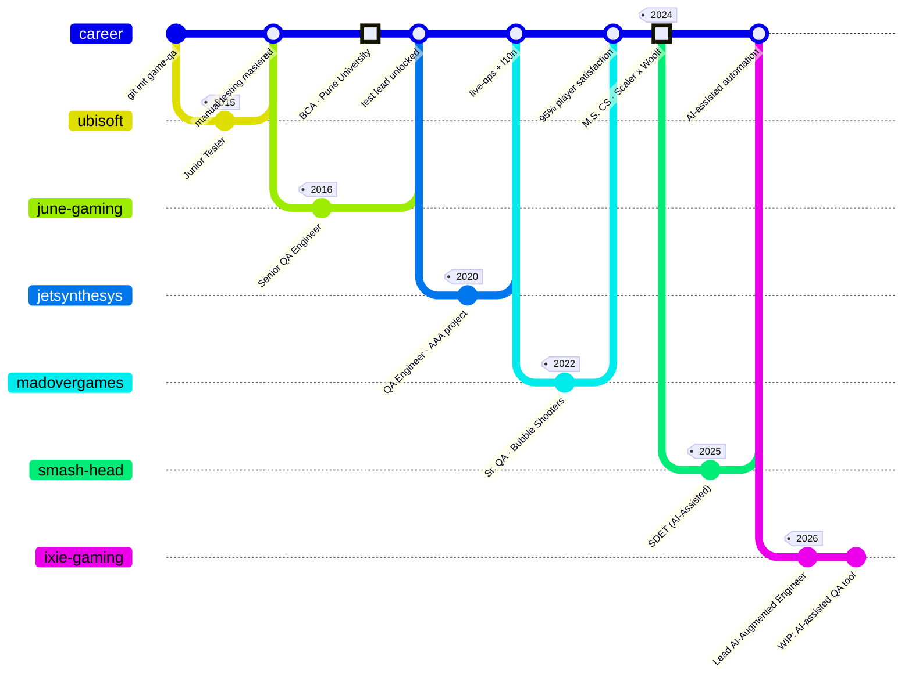

<!-- ░░ PLAYER 1 READY ░░ -->
<div align="center">


<a href="#-whoami"></a>


<br/><br/>

<a href="#-whoami"></a>
<a href="#-skill-tree"></a>
<a href="#-quest-log"></a>
<a href="#-achievements"></a>
<a href="#-telemetry"></a>
<a href="#-connect"></a>

</div>

---

## 👾 whoami

```console
sandesh@bangalore:~$ whoami
Sandesh Kadam · Lead AI-Augmented Engineer @ Indium Software (iXie Gaming)

sandesh@bangalore:~$ cat about.txt
SDET turned AI-Augmented Engineer with 10+ years in game QA.
R&D on AI-assisted QA prototypes and automation with Unity, AltTester,
Unity ML-Agents, Codex CLI and Ollama. I use coding agents to ship
QA automation and mobile games faster.

sandesh@bangalore:~$ ps aux | grep --current
▸ building an AI-assisted QA tool on open-source LLMs (test generation + RAG)
▸ training gameplay agents with Unity ML-Agents
▸ shipping portfolio games with Unity MCP + Codex CLI
▸ mentoring trainees with structured learning plans

sandesh@bangalore:~$ cat /etc/locale
languages: English, Hindi
```

---

## 🧠 Skill Tree

<div align="center">
  
</div>

```text
~/skills $ tree --dirsfirst
.
├── ai-augmented/
│   ├── llms, rag, evals
│   ├── langgraph, langflow, ollama
│   └── coding-agents/  → codex-cli, claude-code, unity-mcp
├── game-dev/
│   ├── unity-engine
│   ├── unity-ml-agents          # training gameplay agents
│   └── unity-test-framework
├── test-automation/
│   ├── selenium-webdriver, alttester-unity
│   ├── java + testng
│   ├── rest-assured, postman    # API automation
│   ├── bdd
│   └── http-toolkit             # API penetration testing
├── testing-types/
│   └── load · api · functional · regression · smoke · unit
│       integration · localization · exploratory · playtesting
└── workflow/
    ├── git
    └── trello                   # defect tracking

6 directories, 1 relentless bug hunter
```

---

## 📜 Quest Log



> 🕹️ Click a level to expand it.

<details open>
<summary><b>🟢 LVL 06 · Lead AI-Augmented Engineer</b> — Indium Software (iXie Gaming) &nbsp;<code>May 2026 → now</code></summary>

- 🤖 Building an AI-assisted QA tool demo that plugs open-source LLMs into test generation
- 📚 Built knowledge-retrieval workflows that make QA information easier to find
- ⚡ Using coding agents (Codex CLI) to speed up prototype development
- 🎮 Built **3 portfolio games** AI-augmented, with Unity MCP + Codex CLI
- 🧠 R&D and prototyping with Unity ML-Agents to evaluate gameplay agent training
- 🧑‍🏫 Leading and mentoring trainees with structured learning plans

</details>

<details>
<summary><b>🔵 LVL 05 · SDET (AI-Assisted)</b> — Smash Head Studio &nbsp;<code>Sep 2025 → Apr 2026</code></summary>

- 🧪 Automated mobile games and an internal web tool with Selenium WebDriver, AltTester Unity, Java and TestNG; API automation with Rest Assured
- 🔁 Load, API, functional, regression, smoke, unit and integration testing with the Unity Test Framework
- 🛡️ Designed test plans, scenarios and scripts; ran API penetration tests with HTTP Toolkit to find and fix security vulnerabilities
- 🐞 Tracked defects in Trello for clear communication and fast resolution
- ⚡ Used Codex CLI and Claude Code to raise productivity significantly

</details>

<details>
<summary><b>🟣 LVL 04 · Senior QA Engineer</b> — MadOverGames &nbsp;<code>Aug 2022 → Jan 2023</code></summary>

- 🫧 Tested multiple Bubble Shooter titles → **95% user satisfaction**
- 🧩 Designed test cases for game features → **+20% feature effectiveness**
- 📅 Planned and ran **5+ test schedules and strategies**, **100% on time**
- 🎯 Playtested extensively to surface critical improvements and keep games stable

</details>

<details>
<summary><b>🟠 LVL 03 · QA Engineer</b> — JetSynthesys &nbsp;<code>Nov 2020 → Jun 2022</code></summary>

- 🏗️ Built test processes and plans from the ground up for a **AAA project**
- 📺 Worked with the Crunchyroll team on event launches and a live-ops test plan
- 🌍 Localization testing across multiple languages
- 🧑‍🏫 Trained and led junior testers → **+50% team productivity**
- ⚙️ Streamlined processes for better operational efficiency

</details>

<details>
<summary><b>🟡 LVL 02 · Senior QA Engineer</b> — June Gaming, Pune &nbsp;<code>Apr 2016 → Aug 2020</code></summary>

- 🎮 Functional and non-functional testing across multiple game titles
- 📋 Led test planning and delegated tasks to keep the team aligned and on schedule
- 💥 Monitored ANRs and crashes and documented findings in the bug base
- 🗂️ Maintained and executed test cases; reported issues on Trello
- 🔍 Helped with game requirement analysis to align testing with project goals

</details>

<details>
<summary><b>⚪ LVL 01 · Junior Tester</b> — Ubisoft India &nbsp;<code>Mar 2015 → Dec 2015</code></summary>

- 🔎 Ran **50+ exploratory, functional and regression tests** on game features
- ✅ **100% quality-gate pass rate** before release
- 📝 Wrote defect reports with repro steps and screenshots
- 📈 **+20% efficiency** through process improvements

</details>

---

## 🏆 Achievements

```diff
$ run-tests --suite career

  career.spec
+ ✔ Ubisoft       › 100% quality-gate pass rate before release
+ ✔ Ubisoft       › +20% efficiency through process improvements
+ ✔ JetSynthesys  › +50% team productivity after training junior testers
+ ✔ MadOverGames  › 95% user satisfaction across Bubble Shooter titles
+ ✔ MadOverGames  › 5+ test strategies delivered 100% on time
+ ✔ iXie Gaming   › 3 portfolio games built AI-augmented
- ✘ sleep.spec    › expected 8h, received 4h (flaky since 2015)

  Tests: 6 passed, 1 flaky · Studios: 6 · XP: 10+ years
```

---

## 🎓 Save Points

| 💾 | Degree | School | Year |
|:--:|--------|--------|:----:|
| 🎓 | M.S. Computer Science | Scaler × Woolf University | 2024 |
| 🎓 | Bachelor of Computer Applications | Pune University | 2016 |

---

## 📊 Telemetry

<div align="center">
  
  
  
</div>

---

## 📡 Connect

<div align="center">
  <a href="https://www.linkedin.com/in/sandesh-kadam-676776ab/"></a>&nbsp;
  <a href="https://twitter.com/TabulaRasa3033"></a>&nbsp;
  <a href="mailto:sandeshkadam09123@gmail.com"></a>&nbsp;
  <a href="https://github.com/DViceman09"></a>
</div>

<br/>

<details>
<summary><kbd>↑</kbd> <kbd>↑</kbd> <kbd>↓</kbd> <kbd>↓</kbd> <kbd>←</kbd> <kbd>→</kbd> <kbd>←</kbd> <kbd>→</kbd> <kbd>B</kbd> <kbd>A</kbd> &nbsp;<i>enter the code…</i></summary>

```text
🕹️  CHEAT ACTIVATED: +30 lives

    class   : Bug Hunter → AI-Augmented Engineer
    perks   : reads crash logs for fun · trains agents to play-test · speaks fluent Trello
    lore    : once launched live-ops events alongside the Crunchyroll team
    quest   : make every game ship with fewer bugs than it started with
```

</details>

<div align="center">

<sub>Thanks for playing ▸ insert coin to continue 🪙</sub>


</div>
