<div align="center">
  
</div>

<br/>

### `~/now`

```console
sandesh@ixie:~$ tail -f now.log
[building]     an AI-assisted QA tool on open-source LLMs: test generation + knowledge retrieval
[researching]  gameplay-agent training with Unity ML-Agents
[shipped]      3 portfolio games, built AI-augmented with Unity MCP + Codex CLI
[mentoring]    trainees, with structured learning plans
```

### `~/career`

```console
sandesh@ixie:~$ git log --oneline career
* 2026  (HEAD -> career)  Lead AI-Augmented Engineer  ·  iXie Gaming / Indium Software
* 2025                    SDET (AI-Assisted)          ·  Smash Head Studio
* 2024                    M.S. Computer Science       ·  Scaler × Woolf University
* 2022                    Senior QA Engineer          ·  MadOverGames
* 2020                    QA Engineer                 ·  JetSynthesys
* 2016                    Senior QA Engineer          ·  June Gaming
* 2016                    BCA                         ·  Pune University
* 2015  (tag: init)       Junior Tester               ·  Ubisoft India
```

<details>
<summary><code>$ git show --stat career</code> &nbsp;·&nbsp; expand the full changelog</summary>
<br/>

**`2026 → now`** &nbsp; **Lead AI-Augmented Engineer** · iXie Gaming (Indium Software)
- Building an AI-assisted QA tool demo that brings open-source LLMs into test generation
- Built knowledge-retrieval workflows that make QA information easier to find
- R&D and prototyping with Unity ML-Agents to evaluate gameplay-agent training
- Built 3 portfolio games AI-augmented, with Unity MCP + Codex CLI
- Leading and mentoring trainees with structured learning plans

**`2025 → 2026`** &nbsp; **SDET (AI-Assisted)** · Smash Head Studio
- Automated mobile games and an internal web tool: Selenium WebDriver, AltTester Unity, Java, TestNG; API automation with Rest Assured
- Load, API, functional, regression, smoke, unit and integration testing with the Unity Test Framework
- API penetration testing with HTTP Toolkit to find and fix security vulnerabilities
- Used Codex CLI and Claude Code to raise output significantly

**`2022 → 2023`** &nbsp; **Senior QA Engineer** · MadOverGames
- Tested multiple Bubble Shooter titles → 95% user satisfaction
- Designed feature test cases → +20% feature effectiveness
- Planned and delivered 5+ test schedules and strategies, all on time

**`2020 → 2022`** &nbsp; **QA Engineer** · JetSynthesys
- Built test processes and plans from the ground up for a AAA project
- Worked with the Crunchyroll team on event launches and a live-ops test plan
- Localization testing across multiple languages
- Trained and led junior testers → +50% team productivity

**`2016 → 2020`** &nbsp; **Senior QA Engineer** · June Gaming, Pune
- Functional and non-functional testing across multiple titles
- Led test planning and delegated work to keep the team on schedule
- Monitored ANRs and crashes and documented findings to improve stability

**`2015`** &nbsp; **Junior Tester** · Ubisoft India
- 50+ exploratory, functional and regression test runs
- 100% quality-gate pass rate before release
- +20% efficiency through process improvements

</details>

### `~/proof`

```diff
sandesh@ixie:~$ mvn test -Dsuite=career

+ PASS  Ubisoft        › 100% quality-gate pass rate before release
+ PASS  JetSynthesys   › +50% team productivity after training junior testers
+ PASS  MadOverGames   › 95% user satisfaction across Bubble Shooter titles
+ PASS  MadOverGames   › 5+ test strategies delivered, all on time
+ PASS  iXie Gaming    › 3 portfolio games built AI-augmented
- FAIL  sleep.spec     › expected 8h, received 4h (flaky since 2015)

Tests run: 6, Passed: 5, Flaky: 1
```

### `~/toolkit`


`LLMs` `RAG` `Evals` `LangGraph` `LangFlow` `Ollama` `Codex CLI` `Claude Code` `Unity MCP` `ML-Agents` `AltTester` `TestNG` `Rest Assured` `HTTP Toolkit` `Trello`

### `~/activity`


### `~/contact`

<a href="https://www.linkedin.com/in/sandesh-kadam-676776ab/"></a>
<a href="https://twitter.com/TabulaRasa3033"></a>
<a href="mailto:sandeshkadam09123@gmail.com"></a>

<br/><br/>

<div align="center">
  <sub><code>// built with AI, reviewed by a human. same as everything I ship.</code></sub>
  <br/>
  
</div>
